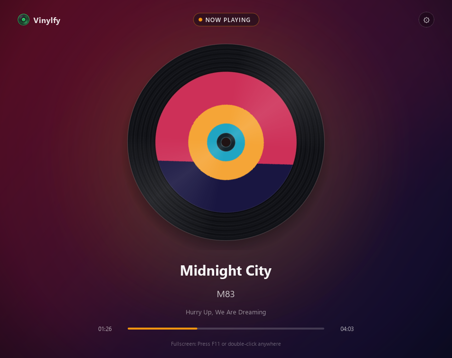

<p align="center">
  
</p>

<h1 align="center">Vinylfy</h1>

<p align="center">
  <b>A sleek desktop Spotify "Now Playing" vinyl visualizer built with Python &amp; PyQt6.</b><br>
  Spins your active Spotify track on a realistic grooved vinyl record with dynamic dominant-color gradients and blurred album artwork.
</p>

<p align="center">
  <a href="https://github.com/yagizsen0/Vinylfy/raw/main/Output/Vinylfy_Setup_v1.0.0.exe">
    
  </a>
</p>

---

## About

**Vinylfy** transforms your desktop or secondary monitor into a living turntable display for Spotify. It continuously syncs with your active Spotify playback in the background, masks high-resolution album covers onto an animated vinyl disc, extracts each album's dominant color palette, and smoothly crossfades an atmospheric blurred backdrop as songs change.

No hardcoded API keys are required—on first launch, **Vinylfy** walks you through entering your own Spotify Developer credentials once and stores them locally on your PC (`%APPDATA%\Vinylfy`).

<p align="center">
  
</p>

---

## Direct Download (Windows Installer)

Want to install **Vinylfy** right away without installing Python?

- **Windows 10 / 11 (x64) Setup Wizard:** [**Direct Download `Vinylfy_Setup_v1.0.0.exe`**](https://github.com/yagizsen0/Vinylfy/raw/main/Output/Vinylfy_Setup_v1.0.0.exe) *(repository path: [`Output/Vinylfy_Setup_v1.0.0.exe`](Output/Vinylfy_Setup_v1.0.0.exe))*
- Includes Start Menu entry, optional Desktop shortcut, and standard Windows Uninstaller.

---

## Features

- **Realistic Spinning Vinyl UI:** High-DPI antialiased vinyl grooves, stationary specular light reflections, transparent center spindle hole, and smooth 60 FPS `QPropertyAnimation` rotation that pauses seamlessly in place when playback is paused.
- **Dynamic Crossfading Backgrounds:** Extracts dominant colors via Median-Cut quantization and blends them with Gaussian-blurred cover art using smooth `InOutCubic` transitions.
- **One-Time Local Credential Setup:** Built-in onboarding dialog saves your Spotify **Client ID** and **Client Secret** locally in `%APPDATA%\Vinylfy\config.json`—subsequent launches open straight into the player.
- **Non-Blocking Async Engine:** Spotify Web API polling, image downloading, blur filtering, and palette extraction run entirely inside a background `QThread`.
- **Instant Fullscreen Mode:** Toggle between windowed and fullscreen display anytime with **`F11`** or **double-clicking** anywhere on the screen (`ESC` exits fullscreen).

---

## Spotify API Setup (First Launch)

1. Go to the [Spotify Developer Dashboard](https://developer.spotify.com/dashboard) and click **Create app**.
2. Fill in an app name/description, check **Web API**, and add the following **Redirect URI**:
   ```text
   http://127.0.0.1:8888/callback
   ```
3. Open **Settings** in your Spotify app dashboard and copy your **Client ID** and **Client Secret**.
4. Launch **Vinylfy**, paste both keys into the setup screen, and click **Save & Launch Vinylfy**.
5. Approve Spotify read access in your browser once—your token is cached locally for future sessions. *(You can update your keys anytime via the top-right **⚙** button.)*

---

## Running from Source

```powershell
git clone https://github.com/yagizsen0/Vinylfy.git
cd Vinylfy
pip install -r requirements.txt
python main.py
```

---

## Building the `.exe` & Setup Installer Yourself

```powershell
.\build_installer.bat
```

Or manually:
1. Build the executable bundle with **PyInstaller**:
   ```powershell
   pip install pyinstaller
   pyinstaller --noconfirm --clean Vinylfy.spec
   ```
2. Compile [`installer.iss`](installer.iss) using [Inno Setup 6](https://jrsoftware.org/isdl.php) to generate `Output\Vinylfy_Setup_v1.0.0.exe`.
